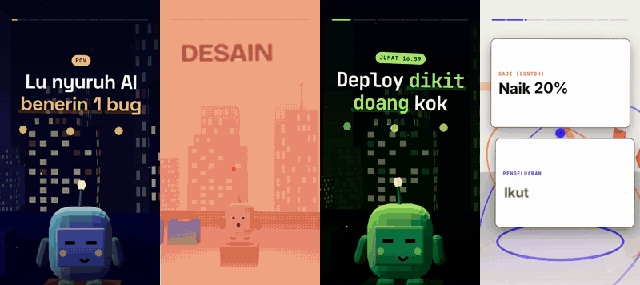

<div align="center">

# 🎬 Nonstop Motion

**Skill Claude buat bikin video vertikal full motion graphics: Reels, Shorts, TikTok.**
Dunia 3D low-poly · shot kamera sinematik · grafik kinetik · cut yang pas sama ketukan musik.

[English](README.md) · **Bahasa Indonesia**



</div>

---

## Apa yang dilakukan

Lu kasih topik ke Claude. Claude nulis **naskah beat** pendek (JSON), terus engine Remotion yang udah disediain nge-render jadi MP4 1080×1920, lengkap sama musik dan efek suara.

```
topik → Claude bikin scripts/topik.json → lint → render → video.mp4
```

| | |
|---|---|
| 🌆 **Dunia 3D** | Set low-poly (meja kerja malam, rooftop kota, panggung data) plus maskot 3D **Blip** di belakang grafiknya. Empat tema bisa ngubah suasana satu dunia. |
| 🎥 **14 shot kamera** | snap-zoom, vertigo (dolly-zoom), whip, crane naik/turun, dutch, orbit, low-hero, top-down, spiral, truck, push-in, pull-out, zoom ke layar. Dipilih per beat dan gak pernah sama dua kali berturut-turut. |
| 🥁 **Sinkron ketukan** | Musik original hasil generate di 92 / 118 / 140 bpm. Durasi beat dibulatkan ke ketukan, jadi tiap cut jatuh pas di kick. Kamera nge-punch tiap ketukan, plus whoosh tiap cut. |
| ⚡ **Cepat tapi kebaca** | Durasi tiap beat dihitung dari jumlah kata dan kecepatan baca, lalu dibulatkan ke ketukan musik berikutnya. |
| 🧩 **Topik apa aja** | 10 tipe beat (hook, statement, dialog, stat, list, compare, ui, chat, punch, cta) × 4 tema × 3 tempo × 7 alur cerita. |
| 🧲 **Retensi bawaan** | Hook muncul di frame pertama, satu kata di-highlight per beat, punch layar penuh, progress bar bersegmen, CTA berdenyut. |

## Instalasi

### Opsi A: plugin Claude Code (disarankan)
```bash
/plugin marketplace add zallxz/motion-content-shorts
/plugin install nonstop-motion@nonstop-motion
```
Pas pertama kali dipakai, Claude otomatis jalanin `npm install` di folder `template/` skill-nya, jadi gak ada setup tambahan.

### Opsi B: salin folder skill
```bash
git clone https://github.com/zallxz/motion-content-shorts
cp -r motion-content-shorts/skills/nonstop-motion ~/.claude/skills/
cd ~/.claude/skills/nonstop-motion/template && npm install
```

### Opsi C: Claude.ai
Zip folder `skills/nonstop-motion`, terus upload sebagai skill di pengaturan Claude.ai.

**Kebutuhan:** Node.js 20+ dan Chrome/Chromium (Remotion bakal download sendiri kalau belum ada).

## Cara pakai

Tinggal minta ke Claude:

> *"Bikinin reel motion graphic soal 3 kesalahan keuangan setelah naik gaji, gaya editorial, tempo cepat."*

> *"Make a reel about why cats love boxes, paper style, hyper tempo."*

Naskah bisa ditulis dalam **bahasa apa aja**, termasuk bahasa gaul (lu/gw). Font bawaan udah ngecover semua huruf Latin. Buat Jepang/Arab, lihat `references/extending.md`.

### Render manual
```bash
cd skills/nonstop-motion/template
npm run lint:script -- scripts/demo-science.json                                     # cek tempo + rencana shot
npx remotion render NonstopShort out/draft.mp4 --props=scripts/demo-science.json --scale=0.4
npx remotion render NonstopShort out/video.mp4 --props=scripts/demo-science.json
npx remotion studio                                                                   # preview interaktif
npm run music -- --bpm 128 --bars 32 --style fast                                    # bikin track baru
```

### Contoh naskah beat
```json
{
  "meta": { "title": "Benerin bug", "theme": "midnight", "tempo": "fast" },
  "beats": [
    { "type": "hook", "kicker": "POV", "text": "Lu nyuruh AI *benerin 1 bug*", "mascot": "smug" },
    { "type": "ui", "title": "my-app — build", "lines": ["$ npm run build", "✗ 37 errors found"], "status": "error" },
    { "type": "punch", "text": "Secara teknis… dia bener.", "shot": "whip" },
    { "type": "cta", "text": "Pernah ngalamin juga?", "button": "Follow buat part 2" }
  ]
}
```
Semua tipe beat ada di [`skills/nonstop-motion/references/beats.md`](skills/nonstop-motion/references/beats.md). Dokumen referensinya berbahasa Inggris karena dibaca oleh Claude.

## Tema & tempo

| tema | tampilan | cocok buat |
|---|---|---|
| `midnight` | kota malam, ungu + aksen amber hangat | teknologi, AI, cerita, skit POV |
| `paper` | siang pastel, outline ala stiker | edukasi, sains, lifestyle, komedi |
| `terminal` | malam neon hijau ala hacker | humor programmer, keamanan, gaming |
| `editorial` | tampilan "clay" bersih di siang hari, huruf serif | keuangan, bisnis, berita |

| tempo | bpm | kecepatan baca | nuansa |
|---|---|---|---|
| `chill` | 92 | 2,6 kata/detik | storytelling |
| `fast` | 118 | 3,5 kata/detik | default |
| `hyper` | 140 | 4,0 kata/detik | meme, list kilat |

Opsi lain: `"mascot": false`, `"world": "flat"` (2D aja, sekitar 3× lebih cepat), `"music": { "file", "bpm" }` atau `false`, `"sfx": false`.

## Waktu render
3D-nya pakai WebGL software biar bisa jalan di mana aja, termasuk server tanpa GPU. Perkiraannya 5–8 menit buat video 20–25 detik di mesin 2 core. Kalau komputer lu punya GPU, set `Config.setChromiumOpenGlRenderer("angle")` di `remotion.config.ts`. Buat draft cepat, pakai `--scale=0.4`.

## Struktur repo
```
.claude-plugin/           manifest plugin + marketplace
skills/nonstop-motion/
├── SKILL.md              instruksi yang diikuti Claude
├── references/           beat, kamera & musik, adaptasi niche, hook & retensi,
│                         hitungan tempo, prinsip gaya, aturan orisinalitas, cara extend
└── template/             engine Remotion
    ├── src/              beat, tema, timing, motion, three/ (dunia 3D, Blip3D, shot)
    ├── scripts/          naskah demo, linter, generator musik, contact sheet QA
    └── public/           font bawaan (OFL), musik + SFX hasil generate
docs/preview.gif
```

## Orisinalitas & lisensi
- Semuanya original: maskot, set 3D, musik dan SFX hasil generate. Gak ada yang dicontek dari kreator mana pun.
- Aturan skill ngelarang karakter berhak cipta, niru format kreator lain, dan statistik karangan (`references/originality.md`).
- Kode: **MIT**. Font bawaan (Inter, Space Grotesk, Bricolage Grotesque, JetBrains Mono, Instrument Serif): **SIL Open Font License**. Musik/SFX hasil generate: bebas dipakai, termasuk buat komersial.
