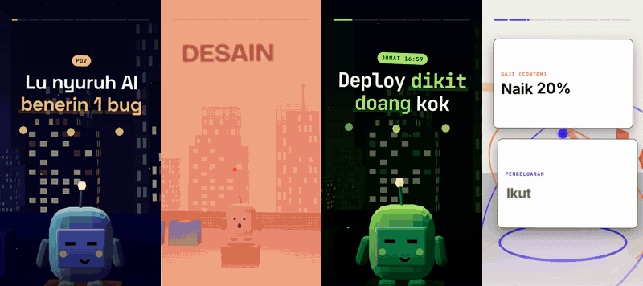

<div align="center">

# 🎬 Nonstop Motion

**A Claude skill for full-motion-graphics vertical videos: Reels, Shorts, TikTok.**
Low-poly 3D world · cinematic camera shots · kinetic graphics · cuts synced to the music.

**English** · [Bahasa Indonesia](README.id.md)



</div>

---

## What it does

You give Claude a topic. Claude writes a short **beat script** (JSON), and the bundled Remotion engine renders a 1080×1920 MP4 with music and sound effects.

```
topic → Claude writes scripts/topic.json → lint → render → video.mp4
```

| | |
|---|---|
| 🌆 **3D world** | Low-poly sets (night desk, city rooftop, data stage) with a 3D mascot, **Blip**, behind the graphics. Four themes re-light the whole world. |
| 🎥 **14 camera shots** | snap-zoom, vertigo (dolly-zoom), whip, crane up/down, dutch, orbit, low-hero, top-down, spiral, truck, push-in, pull-out, screen push. Picked per beat and never repeated back-to-back. |
| 🥁 **Beat-synced** | Original generated music at 92 / 118 / 140 bpm. Beat lengths snap to the grid, so every cut lands on a kick. The camera punches on each beat, and a whoosh plays on every cut. |
| ⚡ **Fast but readable** | Each beat's duration is computed from its word count and reading speed, then rounded up to the next musical beat. |
| 🧩 **Any topic** | 10 beat types (hook, statement, dialog, stat, list, compare, ui, chat, punch, cta) × 4 themes × 3 tempos × 7 story arcs. |
| 🧲 **Retention built in** | Hook visible on frame 0, one emphasized word per beat, full-screen punches, a segmented progress bar, and a pulsing CTA. |

## Install

### Option A: Claude Code plugin (recommended)
```bash
/plugin marketplace add zallxz/motion-content-shorts
/plugin install nonstop-motion@nonstop-motion
```
On first use Claude runs `npm install` inside the skill's `template/` folder automatically, so there's nothing else to set up.

### Option B: copy the skill folder
```bash
git clone https://github.com/zallxz/motion-content-shorts
cp -r motion-content-shorts/skills/nonstop-motion ~/.claude/skills/
cd ~/.claude/skills/nonstop-motion/template && npm install
```

### Option C: Claude.ai
Zip the folder `skills/nonstop-motion` and upload it as a skill in Claude.ai settings.

**Requirements:** Node.js 20+ and Chrome/Chromium (Remotion downloads one if missing).

## Use it

Just ask Claude:

> *"Make a motion-graphic reel about 3 money mistakes people make after a raise, editorial style, fast tempo."*

> *"Bikinin reel soal kenapa kucing suka kotak, gaya paper, tempo hyper."*

Scripts can be written in **any language**. The fonts cover the full Latin set; see `references/extending.md` for CJK/Arabic.

### Manual render
```bash
cd skills/nonstop-motion/template
npm run lint:script -- scripts/demo-science.json                                     # check pacing + shot plan
npx remotion render NonstopShort out/draft.mp4 --props=scripts/demo-science.json --scale=0.4
npx remotion render NonstopShort out/video.mp4 --props=scripts/demo-science.json
npx remotion studio                                                                   # interactive preview
npm run music -- --bpm 128 --bars 32 --style fast                                    # generate a new track
```

### A beat script
```json
{
  "meta": { "title": "Bug fix", "theme": "midnight", "tempo": "fast" },
  "beats": [
    { "type": "hook", "kicker": "POV", "text": "You asked AI to *fix one bug*", "mascot": "smug" },
    { "type": "ui", "title": "my-app — build", "lines": ["$ npm run build", "✗ 37 errors found"], "status": "error" },
    { "type": "punch", "text": "Technically… it's right.", "shot": "whip" },
    { "type": "cta", "text": "Ever happened to you?", "button": "Follow for part 2" }
  ]
}
```
See [`skills/nonstop-motion/references/beats.md`](skills/nonstop-motion/references/beats.md) for every beat type.

## Themes & tempos

| theme | look | good for |
|---|---|---|
| `midnight` | night city, indigo + warm amber | tech, AI, stories, POV skits |
| `paper` | sunny pastel, sticker outlines | education, science, lifestyle, comedy |
| `terminal` | neon-green hacker night | dev humor, security, gaming |
| `editorial` | clean clay daylight, serif | finance, business, news |

| tempo | bpm | read speed | feel |
|---|---|---|---|
| `chill` | 92 | 2.6 words/s | storytelling |
| `fast` | 118 | 3.5 words/s | default |
| `hyper` | 140 | 4.0 words/s | memes, rapid lists |

Other options: `"mascot": false`, `"world": "flat"` (2D only, about 3× faster), `"music": { "file", "bpm" }` or `false`, `"sfx": false`.

## Render time
3D uses software WebGL, so it runs anywhere, including servers with no GPU. Expect roughly 5–8 min for a 20–25 s video on a 2-core machine. On a computer with a GPU, set `Config.setChromiumOpenGlRenderer("angle")` in `remotion.config.ts`. For quick drafts, use `--scale=0.4`.

## Repository layout
```
.claude-plugin/           plugin + marketplace manifests
skills/nonstop-motion/
├── SKILL.md              instructions Claude follows
├── references/           beats, camera & music, niche adaptation, hooks & retention,
│                         tempo math, style principles, originality rules, extending
└── template/             Remotion engine
    ├── src/              beats, themes, timing, motion, three/ (3D world, Blip3D, shots)
    ├── scripts/          demo scripts, linter, music generator, QA contact sheet
    └── public/           bundled fonts (OFL), generated music + SFX
docs/preview.gif
```

## Originality & licenses
- Everything is original: the mascot, the 3D sets, the generated music and SFX. Nothing is copied from any creator.
- The skill's rules forbid copyrighted characters, cloned creator formats, and invented statistics (`references/originality.md`).
- Code: **MIT**. Bundled fonts (Inter, Space Grotesk, Bricolage Grotesque, JetBrains Mono, Instrument Serif): **SIL Open Font License**. Generated music/SFX: free to use, including commercially.
